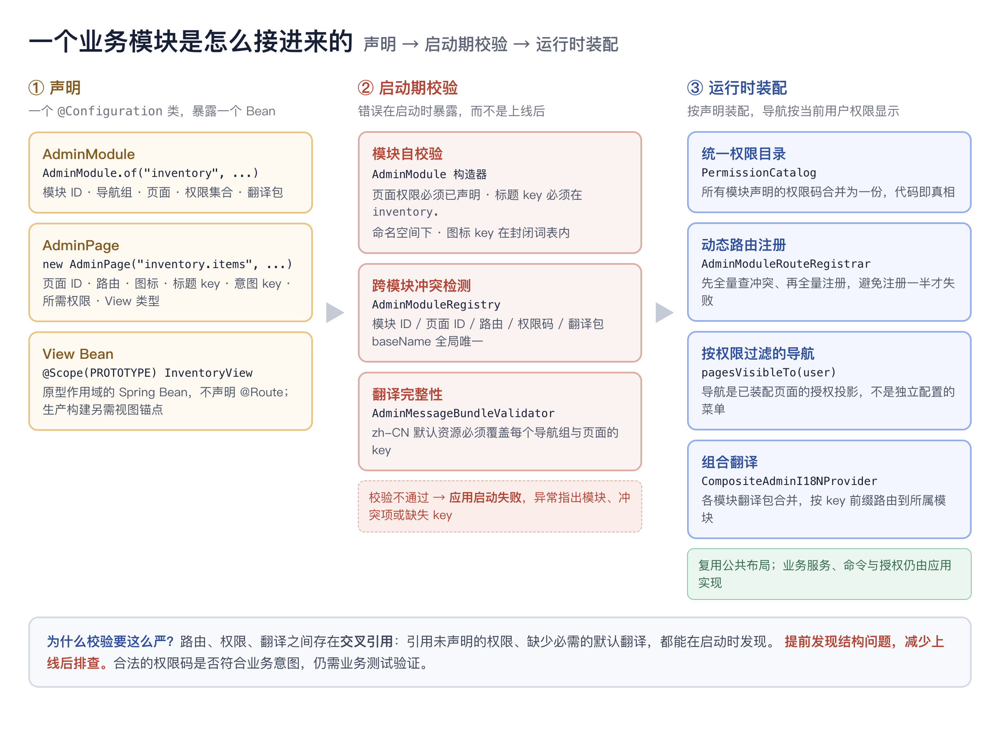
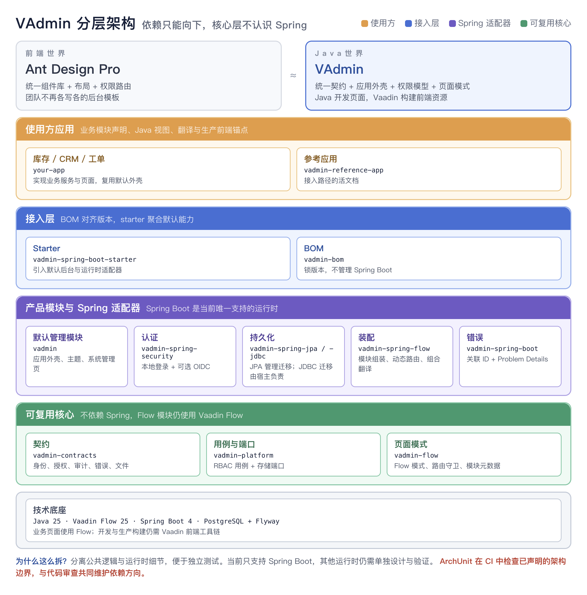

# VAdmin

简体中文 | [English](README.md)

**开箱即用的 Java 管理后台，让你专注业务开发。**

VAdmin 基于 Spring Boot 和 [Vaadin Flow](https://vaadin.com/docs/latest/flow)，
为 Java 应用提供完整的管理后台：登录认证、用户与角色管理、权限控制、操作审计，
以及统一的应用布局和常用页面模式。

项目灵感来自 `Ant Design Pro`：把管理后台中反复需要的基础
能力准备好，让开发者从业务功能开始。VAdmin 将这一思路带到 Java 技术栈，使用
Java 编写业务页面，并与现有 Spring 服务集成。

## 为什么做 VAdmin

一个团队维护多个内部系统时，登录、权限、导航、用户管理、审计日志，以及列表和
编辑页面的交互，往往会在每个项目中重新实现。这些基础能力需要持续维护，也容易
在不同系统中逐渐产生差异。

VAdmin 希望为这些共同需求提供统一的起点。通过 Maven 依赖接入完整的管理后台，
业务应用负责自己的领域逻辑、服务和页面，VAdmin 负责公共管理体验。业务页面使用
Vaadin Flow 的服务端 Java 模型开发，可以直接调用 Spring 服务；生产环境需要的
前端资源由 Vaadin 工具链构建。

## 核心能力

| 能力 | 开箱即用的内容 |
| --- | --- |
| 登录与权限控制 | 本地登录、基于角色的权限、按权限显示导航，以及页面路由访问检查。 |
| 系统管理 | 内置用户、角色、权限和操作审计页面。 |
| 应用布局 | 响应式导航、用户菜单，以及可配置的产品名称。 |
| 常用页面模式 | 页面标题、工具栏、数据工作区、详情弹窗，以及加载、空数据和失败状态。 |
| 业务模块扩展 | 通过 `AdminModule` 统一注册 Java 视图、导航、权限和翻译。 |
| 多语言与外观 | 内置中英文，直接使用 Vaadin Aura，支持跟随系统、浅色和深色配色方案。 |
| 运行诊断 | 请求关联 ID，以及符合 RFC 9457 的 HTTP Problem Details 错误响应。 |

适用于内部管理工具、运营工作台，以及以 Java 和 Spring Boot 为主要技术栈的业务
管理系统。

## 业务应用与 VAdmin 的分工

| 业务应用贡献什么 | VAdmin 提供什么 |
| --- | --- |
| 领域逻辑、Spring 服务和业务命令 | 统一的身份、授权和审计契约。 |
| 使用共享 Flow 模式编写的 Java 业务页面 | 默认应用布局、导航和系统管理页面。 |
| 页面、权限、导航组和翻译等模块元数据 | 启动期校验、路由注册、按权限显示的导航和组合翻译。 |
| 部署配置与认证集成 | Spring Boot 适配器、starter 和用于版本对齐的 BOM。 |

正常接入从默认管理后台开始。配置产品名称，再按业务需要贡献模块，逐步构建自己的
管理系统。

## 接入自己的应用

在 Spring Boot 应用中导入 `vadmin-bom`，并添加 `vadmin-spring-boot-starter`。
starter 提供默认布局和系统管理功能，你通过 Java 视图和 `AdminModule` Bean 添加
自己的业务页面。

模块元数据把一个业务页面与它的路由、导航组、权限和翻译联系起来，接入过程如下：



例如，在业务模块配置中声明一个库存页面：

```java
@Bean
AdminModule inventoryModule() {
    var read = PermissionCode.of("inventory:item:read");
    return AdminModule.of("inventory",
        List.of(new AdminNavigationGroup("inventory", "inventory.navigation", 200)),
        List.of(new AdminPage("inventory.items", "inventory", "inventory.items.title",
            "inventory.items.intent", "cube", 100, "inventory/items", read,
            InventoryView.class)),
        Set.of(read),
        List.of(new AdminMessageBundle("inventory", "i18n.inventory")));
}
```

将 `InventoryView` 注册为原型作用域的 Spring Bean。VAdmin 根据模块元数据注册
路由，视图不声明 `@Route`。提供模块翻译资源，并为生产前端构建声明锚点：

```java
@Uses(InventoryView.class)
public final class InventoryFrontendAnchor extends AdminModuleViewAnchor {
}
```

启动时，VAdmin 检查模块 ID、页面 ID、路由、权限码和翻译包名称是否重复，同时
校验元数据引用及必需的默认翻译。校验通过后，再根据声明装配权限目录、路由、导航
与组合翻译提供者，让配置错误在用户打开页面之前暴露。

依赖与数据库配置见[快速开始](docs/zh-CN/user/getting-started.md)。完整示例、import、
视图注册、翻译和生产锚点要求见[模块开发](docs/zh-CN/user/modules.md)。

## 架构概览

VAdmin 将管理产品、运行时集成，以及可复用的契约和用例分开。默认管理模块拥有
公共布局与系统管理功能，参考应用则演示一个普通业务应用如何使用这些能力。



| 层次 | 主要职责 |
| --- | --- |
| 接入 | `vadmin-spring-boot-starter` 聚合默认能力；`vadmin-bom` 对齐 VAdmin 和 Vaadin 依赖版本。 |
| 管理产品 | `vadmin` 拥有默认布局、全局工具和系统管理页面。 |
| Spring Boot 集成 | `vadmin-spring-flow` 装配模块，`vadmin-spring-security` 集成认证，`vadmin-spring-boot` 处理关联 ID 与 HTTP 错误。 |
| 持久化 | `vadmin-spring-jpa` 提供默认 IAM 和审计存储；`vadmin-spring-jdbc` 是面向使用方自行管理表结构的可选 IAM 适配器。 |
| 可复用核心 | `vadmin-contracts` 定义契约，`vadmin-platform` 实现 RBAC 用例与端口，`vadmin-flow` 提供 Flow 页面模式、导航元数据与视图守卫。 |

契约、平台和 Flow 模块不依赖 Spring 与 Jakarta Persistence，其中 Flow 模块使用
Vaadin Flow。架构测试持续检查这些边界；当前支持的运行时为 Spring Boot。
具体依赖方向与扩展点见[架构说明](docs/zh-CN/dev/architecture.md)。

## 权限如何工作

业务模块在代码中声明 `inventory:item:read`、`inventory:item:update` 这样的权限码，
各模块的声明组成统一权限目录。管理员将权限授予角色，再将角色分配给用户。

VAdmin 按权限过滤导航，并检查已注册页面路由的访问权限。
`PermissionProtectedView` 还提供进入视图前的权限检查。业务服务与命令必须在读取
受保护数据或修改状态之前执行授权检查；隐藏导航或按钮不能代替服务层授权。

本地认证、可选 OIDC 集成、授权变更及部署注意事项见[安全说明](docs/zh-CN/user/security.md)。

## 本地体验

仓库附带一个参考应用，演示普通 Spring Boot 应用如何接入 VAdmin。安装 Docker 后，
在仓库目录执行：

```bash
cp .env.example .env
```

在 `.env` 中设置 `APP_BOOTSTRAP_PASSWORD`，然后启动应用：

```bash
docker compose --env-file .env up --build
```

访问 `http://localhost:8080`，用 `admin` 和该密码登录。参考应用沿用普通使用方的
starter 与模块接入路径。

## 技术栈

当前支持 Java 25、Spring Boot 4.1 和 Vaadin Flow 25.3，默认界面直接使用 Vaadin
Aura。参考应用使用 PostgreSQL 和 Flyway，并提供 Docker 部署示例。

具体依赖版本见[根 POM](pom.xml)。

## 文档

**用户指南**

| 指南 | 链接 |
| --- | --- |
| 快速开始 | [阅读](docs/zh-CN/user/getting-started.md) |
| 模块开发 | [阅读](docs/zh-CN/user/modules.md) |
| 配置参考 | [阅读](docs/zh-CN/user/configuration.md) |
| 外观配置 | [阅读](docs/zh-CN/user/appearance.md) |
| 安全说明 | [阅读](docs/zh-CN/user/security.md) |
| 部署 | [阅读](docs/zh-CN/user/deployment.md) |

**开发者指南**

| 指南 | 链接 |
| --- | --- |
| 架构 | [阅读](docs/zh-CN/dev/architecture.md) |
| 主题策略 | [阅读](docs/zh-CN/dev/theme-tokens.md) |
| 发布指南 | [阅读](docs/zh-CN/dev/release-guide.md) |
| 需求文档 | [阅读](docs/dev/requirements.md) |
| 贡献指南 | [阅读](docs/dev/contributing.md) |

## 开发与验证

```bash
./mvnw -B -ntp verify
./mvnw -B -ntp -Pproduction verify
docker compose --env-file .env.example config
docker build -t vadmin:local .
```

## 开源许可

VAdmin 使用 [Apache License 2.0](LICENSE) 开源许可证。

Vaadin 是 Vaadin Ltd. 的商标。本项目与 Vaadin Ltd. 无隶属、赞助或背书关系。
